# Puntr Football Intelligence Engine (PFIE): Product and Technical Blueprint

**Version** 1.0 (draft for owner review) · **Date** 5 November 2026 · **Owner** Puntr · **Site** https://puntr.co.za
**Technical completion target** Monday 9 November 2026 · **Public MVP launch** Tuesday 1 December 2026

> **How to read this document.** Every claim about a provider is tagged. **[V]** means verified from the provider's own page on 5 November 2026. **[P]** means proposed: our design, not yet built. **[C]** means to confirm at implementation: the provider's page did not settle it. Nothing tagged [P] or [C] is a promise, and no data-licensing permission is assumed anywhere.

---

## 1. Executive summary

PFIE is Puntr's own football data layer. It collects fixtures and results from several sources, checks them with ordinary code, stores them with their source and a verification stamp, and serves them to the Puntr app, to CSV and JSON feeds, and later to a public API.

**Three design decisions from the owner, now built into this blueprint:**

1. **AI is not responsible for data truth.** Gemini extracts. Deterministic application code validates. Independent sources corroborate. A model never decides which fixture is correct (section 7).
2. **Founding-member acquisition comes first.** The early-access landing page, sitewide copy and sign-up forms ship before PFIE, while PFIE is still being built. Status: built and on branch `mvp/launch` in pull request #42, waiting for the owner to merge it (section 10, Phase 0).
3. **PFIE is a proprietary platform that becomes an API.** The internal model is API-first, so that Puntr can later supply sports prediction data to other platforms (sections 2 and 13).

**What the research found (all verified 5 November 2026):**

| Finding | Why it matters |
|---|---|
| Firecrawl Free is **1,000 credits a month**, 10 requests a minute on scrape and search, 2 concurrent browsers [V]. | About 33 pages a day. The six-hourly refresh of 50 competitions in the brief would need roughly 6,000 credits a month. The schedule must be tiered (section 8). |
| Firecrawl's JSON extraction mode costs **4 extra credits** a page [V]. | We fetch markdown only (1 credit) and extract with Gemini. |
| Gemini's free tier states **"Used to improve our products: Yes"** [V]. | Only public, non-personal fixture pages may ever be sent to Gemini. This matches the project rule that personal data never goes to an AI service. |
| Parallel gives **$5 of credit a month**, about 5,000 searches, and says a payment card activates it and extra usage is billed to the card [V]. | Not truly R0 unless the card cannot be charged. Owner decision needed (section 8). |
| **Vercel Hobby is restricted to non-commercial use** and cron runs **once a day** [V]. | Puntr carries affiliate and advertising units, which Vercel's definition of commercial use covers. If the project is on Hobby, this is a terms risk that PFIE does not cause but cannot ignore. Scheduling uses Supabase pg_cron, as the repository already does. |
| Supabase Free has **no automatic backups**, 500 MB of database and 500,000 edge invocations a month [V]. | PFIE needs its own backup job (section 9). |
| Fixture data collected from third parties may carry database or copyright protection, and sites' terms apply [C]. | The proprietary asset worth building an API around is Puntr's own community and prediction data, not resold third-party fixtures (section 13). [attorney review] |

**Scope honesty on the 9 November date.** It is four days away. A credible technical completion by then is the core platform: schema, competition registry, a public-domain importer, the extraction and validation pipeline for the priority competitions, corroboration, an admin review queue, CSV and JSON feeds, and monitoring. Reaching all 50 competitions with corroborated data is a rolling activity from 9 November to launch on 1 December, competition by competition. The technical deadline and the launch date are kept separate throughout.

---

## 2. Product vision

PFIE is the foundation of three layers. Only the first is being built now.



- **Layer 1, football facts (PFIE).** Fixtures, results, teams, competitions. Every record carries its sources, a verification state and an audit trail.
- **Layer 2, community data (Puntr-original).** Locked picks, graded track records, consensus and leaderboards. This is generated by Puntr's members and owned by Puntr. It is the strongest candidate for a licensable data product and the one that fits "sports prediction data" best.
- **Layer 3, intelligence (future).** PUNT AI previews and calibrated predictions, always with provenance.

**What PFIE is not at MVP.** It does not provide real-time live scores, betting odds or bookmaker data, and it does not claim to. Fixture collection is a scheduled process with a "last verified" time on every record. Odds stay out of scope in line with the launch rules.

---

## 3. Functional requirements

Priority key: **M** must for 9 November, **S** should by launch on 1 December, **C** could after launch.

| ID | Requirement | Pri |
|---|---|---|
| FR-1 | Discover upcoming fixtures across the competition registry | M |
| FR-2 | Capture home and away team, competition, season, round, date, kick-off, venue | M |
| FR-3 | Detect and record postponed, cancelled and rescheduled fixtures | M |
| FR-4 | Extract structured data with Gemini using a fixed JSON schema and evidence quotes | M |
| FR-5 | Validate every extraction with deterministic code before it can be stored | M |
| FR-6 | Normalise team and competition names to canonical IDs (alias tables) | M |
| FR-7 | Detect duplicates with one natural key per fixture | M |
| FR-8 | Corroborate across independent sources and record every observation | M |
| FR-9 | Compute a confidence score by a fixed formula, never by the model | M |
| FR-10 | Keep source, source URL and verification timestamp on every record | M |
| FR-11 | Collect completed results and store full-time scores | M |
| FR-12 | Never overwrite a verified result with incomplete data; corrections go through review and are logged | M |
| FR-13 | Keep a central registry of competitions, teams, fixtures, results, sources, runs, errors and changes | M |
| FR-14 | Serve the Puntr app through the existing `public.fixtures` table | M |
| FR-15 | CSV and JSON exports | M |
| FR-16 | Admin queue for disputed fixtures and unresolved team names | M |
| FR-17 | Quota ledger, dynamic schedule reduction and exhaustion handling | M |
| FR-18 | Daily historical reconciliation and weekly integrity audit | S |
| FR-19 | Source reliability tracking from agreement history | S |
| FR-20 | Versioned read-only API with keys and metering | C |

---

## 4. Source strategy

**Rights come before reach.** Inclusion of a site in this list is not authorisation to scrape or republish it. For every source, the terms and `robots.txt` are read and recorded in `data_sources` before it is switched on, and the answer is stored with the date it was checked.

### 4.1 Source tiers

| Tier | What it is | How PFIE may use it |
|---|---|---|
| **A** | Public domain or open licence | Store, serve and redistribute |
| **B** | Free API under its own terms | Use within terms. Commercial use [C] per provider |
| **C** | Official league and federation pages | Corroborate; store extracted facts only, not page content. Terms [C] [attorney review] |
| **D** | Aggregator and media sites | Corroboration only, and only where terms and robots allow automated access. Default: off |
| **X** | Parallel Search | Finds pages. Never a source of truth |

### 4.2 Source evaluation

| Source | Competitions | Data | Method | Update rate | Access and reuse | Reliability (proposed) | Priority |
|---|---|---|---|---|---|---|---|
| **OpenFootball** (github.com/openfootball) | England four levels verified [V]; other country repositories to check [C] | Fixtures, results | Direct fetch of raw files, no Firecrawl credit | Varies by repository and season; freshness unknown [C] | Data "dedicated to the public domain" [V]. Tier A | High for structure, medium for freshness | 1 |
| **football-data.org** | Free plan lists 12 competitions [V] | Fixtures, results (scores delayed on free) | API, 10 calls a minute [V] | Frequent | Commercial use not stated on pricing page [C]; ask the provider. Tier B | High | 1 |
| **Premier League site** | EPL | Fixtures, kick-offs | Firecrawl markdown, then Gemini | Updated by the league | Terms and robots [C]. Tier C | High (official) | 1 |
| **UEFA** | UCL, UEL, UECL, Nations League, Euro | Fixtures, kick-offs | Firecrawl, Gemini | Updated by UEFA | Terms [C]. Tier C | High (official) | 1 |
| **Premier Soccer League (SA)** | Betway Premiership, Motsepe Foundation Championship | Fixtures, results | Firecrawl, Gemini | Updated by the PSL | Terms [C]. Tier C | High (official) | 1 |
| **LaLiga, Bundesliga, Lega Serie A, Ligue 1** | Own leagues | Fixtures | Firecrawl, Gemini | League-managed | Terms [C]. Tier C | High (official) | 2 |
| **CAF** | CAF Champions League, Confederation Cup, AFCON | Fixtures | Firecrawl, Gemini | Irregular | Terms [C]. Tier C | Medium | 2 |
| **ESPN, BBC Sport** | Broad | Fixtures, results | Only if terms permit [C] | Frequent | Automated access is commonly restricted; verify. Tier D | Medium-high | 3 |
| **Soccerway, WorldFootball.net** | Broad | Fixtures, results | Only if terms permit [C] | Frequent | Verify. Tier D | Medium | 3 |
| **Parallel Search** | Not a data source | URL discovery | API, $5 monthly credit [V] | On demand | Card activation and overage billing [V]; commercial terms [C]. Tier X | n/a | Discovery only |

**Reliability is measured, not assumed.** `data_sources.reliability` is recalculated from how often each source's observations agree with the final verified record.

### 4.3 Competition registry (51 targeted, all configurable)

Each competition starts as `planned`. It becomes `active` only when at least one permitted source exists and the corroboration rule can be met. Coverage is never promised ahead of that.

| Group | Competitions |
|---|---|
| England (6) | Premier League, Championship, League One, League Two, FA Cup, EFL Cup |
| Spain (3) | LaLiga, Segunda División, Copa del Rey |
| Germany (3) | Bundesliga, 2. Bundesliga, DFB-Pokal |
| Italy (3) | Serie A, Serie B, Coppa Italia |
| France (3) | Ligue 1, Ligue 2, Coupe de France |
| Europe (5) | UEFA Champions League, Europa League, Conference League, Nations League, Euro |
| Other Europe (7) | Eredivisie, Eerste Divisie, Primeira Liga, Scottish Premiership, Scottish Championship, Süper Lig, Belgian Pro League |
| South Africa (4) | Betway Premiership, Motsepe Foundation Championship, Nedbank Cup, MTN8 |
| Africa (3) | CAF Champions League, CAF Confederation Cup, Africa Cup of Nations |
| International (3) | FIFA World Cup, CAF World Cup qualifiers, UEFA World Cup qualifiers |
| Other markets (11) | Saudi Pro League, MLS, Brazilian Série A, Argentine Primera División, Liga MX, J1 League, A-League, Copa América, Copa Libertadores, Copa Sudamericana, AFC Champions League |

**Priority 1 (daily): 6.** Betway Premiership, Premier League, Champions League, Europa League, Conference League, Motsepe Foundation Championship. **Priority 2 (twice weekly): about 15.** **Priority 3 (weekly): the rest.**

---

## 5. System architecture



### 5.1 Components and responsibilities

| Component | Responsibility |
|---|---|
| **Scheduler** | Supabase `pg_cron` calls `public.invoke_cron(...)`, which calls PFIE server routes. This is the pattern already used by `sync-fixtures`, `sync-results` and `settle` in the repository [V]. Vercel Cron is not used: Hobby allows one run a day [V]. |
| **Planner** | Reads the quota ledger and the competition priority, then chooses which jobs run now. This is where the schedule shrinks when quota is short. |
| **Fetchers** | One adapter per source behind a common interface, extending the existing `SportsProvider` idea in `src/lib/sports/provider.ts`. Tier A and B sources use plain HTTP and cost no Firecrawl credit. |
| **Firecrawl** | Renders pages that need a browser and returns markdown. Server-side only. 1 credit a page [V]. |
| **Content hash cache** | If a page's markdown is unchanged since the last run, Gemini is not called. |
| **Extractor** | Sends page text to Gemini with a fixed JSON schema. Returns candidate fixtures with an evidence quote for each field. |
| **Validator** | Pure code. Schema check, evidence check, football rules, entity resolution (section 7). |
| **Observation store** | Every validated sighting is saved as one row in `fixture_observations`, per source and run. |
| **Corroborator** | Pure code. Compares observations of the same fixture and sets `verified`, `single_source` or `disputed`. |
| **Publisher** | Upserts into `pfie.fixtures` and `pfie.results`, writes `data_change_logs`, and projects verified fixtures into the existing `public.fixtures` read model so picks and settlement keep working. |
| **Exporter** | CSV and JSON feeds from verified data. |
| **Monitor** | Quota ledger, run history, error rates, staleness alarms. |
| **Admin queue** | Screen in `/admin` for disputed fixtures and unresolved team names. |

### 5.2 Repository assessment

The repository already provides: a `public.fixtures` table (text `competition`, `home`, `away`, `kickoff_at`, `status`, scores, `provider`, `provider_ref`, unique on provider and reference), a provider interface, a competition registry file, an API-Football adapter whose account is currently suspended, cron routes for fixture and result sync, a settlement engine that grades picks from finished fixtures, `pg_cron` with an `invoke_cron` helper, and Row Level Security on every table.

**Decision: do not break settlement.** PFIE writes to its own `pfie` schema and publishes to `public.fixtures` with `provider = 'pfie'` and the canonical fixture key as `provider_ref`. The app and `settle.server.ts` keep reading one table. Grading only ever runs on results PFIE has marked `verified`.

---

## 6. Data model



All tables live in schema `pfie`, have Row Level Security on, and grant nothing to `anon` or `authenticated`. Only server code using the service role writes. The app reads through `public.fixtures` and through server routes.

**Canonical IDs.** `competition_id` is a stable slug (`eng-premier-league`). `team_id` is a UUID. Source names never appear in canonical tables: they live in `source_mappings`. The natural key of a fixture is `(competition_id, season, round, home_team_id, away_team_id, leg)`. `fixture_id` is derived from it, so a second ingestion of the same fixture updates the row and cannot duplicate it (idempotent ingestion).

**Time.** `kickoff_utc timestamptz` is the only stored time. `kickoff_local` is computed in `Africa/Johannesburg` at read time using the existing helpers in `src/lib/sast.ts`.

| Table | Key fields | Constraints and indexes |
|---|---|---|
| `competitions` | `competition_id` PK, `name`, `country`, `tier`, `priority`, `season_rule`, `status` (planned, active, paused) | unique `name` per country |
| `teams` | `team_id` PK, `canonical_name`, `country`, `short_name` | unique (`canonical_name`, `country`) |
| `seasons` | `season_id` PK, `competition_id` FK, `label`, `starts_on`, `ends_on` | unique (`competition_id`, `label`) |
| `fixtures` | `fixture_id` PK, `competition_id`, `season_id`, `round`, `leg`, `home_team_id`, `away_team_id`, `kickoff_utc`, `venue`, `match_status`, `verification_status`, `confidence_score`, `source_count`, `last_verified_at`, `last_updated_at` | unique natural key; index (`kickoff_utc`), (`match_status`, `kickoff_utc`); check home is not away |
| `results` | `fixture_id` PK/FK, `home_score`, `away_score`, `verified_at`, `source_count` | check scores are 0 or more; only written when `finished` |
| `data_sources` | `source_id` PK, `domain`, `tier`, `terms_checked_on`, `robots_ok`, `reliability`, `enabled` | unique `domain` |
| `source_mappings` | `mapping_id` PK, `source_id`, `entity_type`, `source_name`, `team_id` or `competition_id` | unique (`source_id`, `entity_type`, `source_name`) |
| `fixture_observations` | `observation_id` PK, `run_id`, `source_id`, `fixture_id` (nullable until resolved), `raw_extract` jsonb, `evidence` jsonb, `content_hash`, `observed_at` | index (`fixture_id`, `source_id`) |
| `ingestion_runs` | `run_id` PK, `job`, `started_at`, `finished_at`, `status`, `calls_firecrawl`, `calls_gemini`, `calls_parallel` | index (`job`, `started_at`) |
| `ingestion_errors` | `error_id` PK, `run_id`, `source_id`, `stage`, `code`, `detail` | index (`run_id`) |
| `data_change_logs` | `change_id` PK, `fixture_id`, `field`, `old_value`, `new_value`, `reason`, `actor`, `changed_at` | append only (no update or delete grants) |

---

## 7. AI extraction workflow

**The rule.** Gemini reads a page and proposes facts. Code checks them. Several independent sources agree or they do not. No step lets a model choose between conflicting versions.



### 7.1 Steps

1. **Fetch.** Firecrawl returns markdown, or a Tier A/B fetcher returns structured data. A content hash skips unchanged pages.
2. **Extract.** One Gemini call per page, temperature 0, response constrained to a JSON schema. For every field the model must return the exact text it read it from (an evidence quote). Several fixtures per call keeps request volume low.
3. **Evidence check (code).** Each extracted value must be found in the page text: team names as text, the date and time as a parseable string in the quoted line. If not, the record is rejected and logged. This is what stops a model from inventing a fixture.
4. **Schema and rules (code).** Valid types and ranges, kick-off inside the season window, home is not away, both teams belong to the competition, scores only on finished matches, allowed status changes only (a finished match never returns to scheduled).
5. **Entity resolution (code).** Names are matched through `source_mappings`. An exact alias match resolves. A near match goes to the admin queue as a proposed alias. Nothing is guessed.
6. **Observe.** The validated record is saved as an observation for that source and run.
7. **Corroborate (code).** Two or more independent sources that agree on teams, date and kick-off within five minutes make the fixture `verified`. One source makes it `single_source`. Disagreement makes it `disputed` and it goes to the admin queue. Independent means a different domain and a different upstream: two sites quoting the same league page count once.
8. **Publish.** Verified and single-source fixtures are written with their state. Disputed ones are held.

### 7.2 Confidence score (proposed, fixed formula, tunable)

| Situation | Score |
|---|---|
| Two or more independent sources agree | 0.90 |
| One Tier A or Tier C (official) source | 0.75 |
| One other source | 0.50 |
| Alias matched fuzzily and approved | minus 0.05 |
| Kick-off changed since last run, not yet re-confirmed | minus 0.15 |
| Source's rolling agreement rate below 90% | minus 0.10 |
| Disputed | recorded as 0 and held |

The score is arithmetic on recorded facts. The model never reports its own confidence and the app never reads one from it.

### 7.3 Integrity rules for a pick-locking product [P]

Puntr locks picks at kick-off, so a wrong kick-off time damages trust. Proposed, owner to decide:

- A pick can open on a `verified` fixture, or a `single_source` fixture from an official source. A fixture with only low-confidence sources is shown as "time to be confirmed" and takes no picks.
- If sources disagree on kick-off, the **earliest credible time** is used for locking until an admin resolves it.
- A kick-off moved later does not reopen picks that already locked.
- A result is only graded when it is `verified` (two sources, or an official Tier A/C source plus no conflict). Anything else waits in the admin queue.

### 7.4 Safety of the extraction itself

- Page text is **untrusted input**. The model is given no tools and no instructions to act, its output is schema-only, and the validator ignores free text. A page that tries to instruct the model cannot change what is stored.
- **No personal data is ever sent to Gemini or Firecrawl.** Only public fixture pages are fetched. Cookies, forms and account pages are never requested.
- Gemini rate limits for the free tier are not published on the pricing or rate-limit pages and must be read from Google AI Studio at implementation [C]. The code reads the limit from configuration and never assumes it.
- Current Google guidance is to use a current Flash or Flash-Lite model for new projects [V]. The model name is a configuration value.

---

## 8. Zero-cost operating model

**Target: R0 of additional cost.** The approved providers are Firecrawl, Gemini, Parallel, Supabase, Vercel and GitHub, on free tiers only. Claude is a development assistant only: production never calls a paid model.

### 8.1 Provider-by-provider free tier (verified 5 November 2026)

| Provider | Free allowance | Rate limits | Terms to settle |
|---|---|---|---|
| **Firecrawl** | 1,000 credits a month, no card [V]. Scrape 1 credit, search 2 credits per 10 results, JSON mode +4 [V] | 10 a minute on scrape, map and search; 2 a minute on crawl; 2 concurrent browsers [V] | Page does not state commercial-use terms for Free; no Data Processing Agreement on Free [V]. [C] [attorney review] |
| **Google Gemini** | Free tier exists; do not rely on any figure here [C] | Per project, read from AI Studio; daily quotas reset at midnight Pacific [V] | Free-tier content is used to improve Google products [V]. Public data only |
| **Parallel Search** | $5 monthly credit per organisation, about 5,000 searches, expires monthly [V] | Search API 600 a minute [V] | Card activates the credit and overage is billed to it [V]. Commercial terms not stated [C] |
| **Supabase** | 500 MB database, 5 GB egress, 500,000 edge invocations, 50,000 monthly active users [V] | n/a | Projects pause after one week of inactivity; no automatic backups on Free [V] |
| **Vercel** | Hobby: 100 cron jobs, once a day, run within the hour (±59 minutes) [V] | n/a | Hobby is non-commercial only; affiliate links and advertising count as commercial [V] |
| **GitHub** | Existing repository and free Actions minutes [C] | n/a | None known for this use |

### 8.2 Volume budget for Firecrawl (1,000 credits a month)

| Use | Calculation | Credits a month |
|---|---|---|
| Priority 1 fixtures pages, daily | 6 competitions × 30 days | 180 |
| Priority 2 pages, twice weekly | 15 × 2 × 4.3 | 129 |
| Priority 3 pages, weekly | 30 × 4.3 | 129 |
| Match-day result verification | about 7 a day | 200 |
| Parallel replaces Firecrawl search for discovery | 0 | 0 |
| **Planned use** | | **638** |
| Reserve for retries and ad hoc fixes | about 25% | 250 |
| **Total** | | **888 of 1,000** |

**The brief's target schedule does not fit free tiers.** Refreshing 50 competitions every six hours is about 6,000 credits a month. The schedule below is what the budget supports, and the planner reduces it further when quota tightens.

| Job | Target in brief | Free-tier schedule [P] |
|---|---|---|
| Full upcoming collection | every 6 hours | Daily for Priority 1; twice weekly Priority 2; weekly Priority 3. Tier A/B sources cost no credits and can run more often |
| Verification | every 3 hours | Re-observe from a second source only when a fixture is within 7 days or unverified |
| Next 48 hours | hourly | Every 3 hours for Priority 1 only, using direct sources first |
| Postponements | every 2 hours | Folded into the 48-hour job; weekend mornings get an extra run |
| Results | every 30 minutes | Every 30 minutes only for matches finished within the last 6 hours, direct sources first |
| Historical reconciliation | daily | Daily, database only, no external calls |
| Integrity audit | weekly | Weekly, database only |

### 8.3 Quota monitoring, graceful degradation and exhaustion



- A **quota ledger** records every call by provider, job and day. The planner reads it before every job.
- Free allowances are **configuration**, not constants, so a changed provider limit is a settings change, not a release.
- Requests are **deduplicated** by URL and content hash within a run and across runs.
- In **Exhausted** mode nothing breaks for members. They see the last verified data with its "last verified" time, and the admin sees an alert.
- **No-cost fallbacks:** Tier A and B sources, the previous verified data, and manual CSV import from the admin screen.

### 8.4 Cost-related decisions for the owner

1. **Vercel plan.** If the project is on Hobby, the commercial-use restriction needs a decision. Moving to a paid plan costs money and conflicts with R0. PFIE does not change this, and does not depend on Vercel Cron.
2. **Parallel.** Use it only if its card can be one with no ability to be charged (for example a prepaid card), or skip it. Discovery can be done by hand for 50 competitions.
3. **Firecrawl and Parallel commercial terms.** Ask in writing before relying on either in a product.

---

## 9. Security and reliability

| Area | Design [P] |
|---|---|
| **Secrets** | Firecrawl, Gemini, Parallel and Supabase service keys exist only in server environment variables. They are never in client code, the repository or logs |
| **Database access** | Schema `pfie` with Row Level Security on every table, no grants to `anon` or `authenticated`, service role only. The app reads `public.fixtures` |
| **Input validation** | Every extraction passes a schema and rules check. Admin inputs use the same schemas. URLs fetched come only from the `data_sources` allow-list |
| **Rate limiting** | Per-provider limiter inside the fetchers, set from configuration. Cron routes require the existing cron secret check (`cron-auth.server.ts`). Public feeds are cached and rate limited |
| **Logging** | `ingestion_runs` and `ingestion_errors` for every run. Logs never contain secrets or personal data |
| **Errors and retries** | At most two retries with backoff, then the job stops for that source and logs the error. No infinite loops, no retry storms |
| **Idempotent ingestion** | Natural key and content hash. Re-running a job changes nothing if nothing changed |
| **Provenance** | Every field traces to an observation, a source, a URL and a time. `data_change_logs` is append only |
| **Backup and recovery** | Supabase Free has no automatic backups [V]. Proposed: a nightly GitHub Actions job calls an authenticated export route and commits CSV snapshots of the PFIE tables to a private repository (facts only, no personal data). Target recovery point 24 hours. Restore is an import script tested before launch |
| **Inactivity pause** | Supabase pauses Free projects after a week without activity [V]; scheduled jobs keep PFIE active, and a weekly check confirms it |

---

## 10. Development roadmap

**Two dates are kept apart.** Technical completion is **Monday 9 November 2026**. The public launch is **Tuesday 1 December 2026**. The 22 days between them are for coverage, quality and monitoring, not for finishing the platform.

| Phase | When | Work | Exit |
|---|---|---|---|
| **0. Founding acquisition** | Now, before PFIE | Early-access landing page `/founding`, sitewide Founding bar, home hero and header and footer copy, sign-up forms already live at `/join`. Social assets and reel prepared. Built; pull request #42 waits for the owner to merge it | Merged and live on puntr.co.za |
| **1. Repository assessment and foundation** | Fri 6 Nov | Migration for schema `pfie`, RLS, seed registry of 51 competitions, `data_sources` and quota ledger | Migration applied, types regenerated |
| **2. Tier A and B integrations** | Fri 6 to Sat 7 Nov | OpenFootball importer, football-data.org adapter, entity resolution and alias tables | England fixtures flowing at zero credits |
| **3. Extraction and normalisation** | Sat 7 to Sun 8 Nov | Firecrawl fetcher, content hash cache, Gemini extractor with evidence quotes, validator | Priority 1 competitions extracting |
| **4. Corroboration and publishing** | Sun 8 Nov | Observation store, corroborator, confidence formula, publisher into `public.fixtures`, admin queue | Verified, single-source and disputed states visible |
| **5. Exports and Puntr integration** | Sun 8 to Mon 9 Nov | CSV and JSON feeds, `last verified` shown in the app, backup job | Feeds download; settlement still passes its tests |
| **6. QA and deployment** | Mon 9 Nov | Data checks against official sources for Priority 1, failure and exhaustion drills, deploy | Technical completion |
| **7. Coverage and monitoring** | 10 to 30 Nov | Switch competitions to `active` one by one, tune thresholds, watch quota and errors | Launch readiness checklist green |
| **8. Launch and post-launch** | From 1 Dec | Daily monitoring, weekly integrity audit, source terms re-check | Stable first month |
| **9. API design** | Q1 2027 | Section 13 stage gates | Decision to build |

---

## 11. Launch readiness checklist

The detailed checklist, with owners and checkboxes, is in `PFIE-Implementation-Checklist.md`. The launch gates are:

- [ ] `/founding`, the sitewide bar and the new hero are live, and sign-ups are being counted
- [ ] Priority 1 competitions are `active` with at least two sources each, or an official source plus a stored terms check
- [ ] No fixture inside the next 7 days is `disputed` and unreviewed
- [ ] Every record shows source and last verified time
- [ ] Settlement grades only `verified` results
- [ ] Quota ledger below 70% on 29 November
- [ ] Backup job has run and a restore has been tested
- [ ] Terms and robots checks are recorded for every enabled source
- [ ] Legal copy is aligned: `/terms`, `/privacy`, `/cookies`, `/affiliate-disclosure`, `/refunds` and the legal changelog [attorney review]
- [ ] No page claims live scores, odds or complete coverage

---

## 12. Risks and mitigations

| Risk | Likelihood | Impact | Mitigation |
|---|---|---|---|
| A wrong fixture or kick-off reaches members | Medium | High | Evidence check, corroboration, earliest-time lock rule, admin queue, audit log |
| Free tier quota runs out mid-month | High | Medium | Tiered schedule, 25% reserve, quota modes, direct sources, manual CSV |
| A provider changes or withdraws its free tier | Medium | Medium | Provider adapters, configuration limits, tier A/B fallbacks |
| Scraping is not permitted for a site | Medium | High | Terms and robots recorded before enabling; official and public-domain sources first; legal review |
| Fixture data is protected by database rights | Medium | High | Store facts only; do not republish source pages; do not resell third-party facts without a licence [attorney review] |
| Free-tier Gemini content use | Certain | Medium | Public pages only; no personal data; no private prompts |
| Parallel or Vercel charges appear | Medium | Low to medium | Card without charge ability; confirm Vercel plan; alert on usage |
| Prompt injection in a scraped page | Low | Medium | No model tools, schema-only output, validator ignores free text |
| Four-day schedule to 9 November slips | High | Medium | Core slice defined in section 1; coverage continues to 30 November |
| Supabase pause or data loss | Low | High | Scheduled activity, nightly export, tested restore |
| Matches postponed after kick-off time changes | High | Medium | Frequent 48-hour checks; status rules; picks policy in 7.3 |
| Founding sign-ups stall while engineering focuses on PFIE | Medium | High | Phase 0 first; campaign assets ready; weekly sign-up review |

---

## 13. Future development opportunities

### 13.1 From PFIE to a data API [P]

PFIE is designed so that a public API is an addition, not a rewrite: stable canonical IDs, provenance on every record, versioned shapes and append-only history.

| Stage | Description | Gate to pass first |
|---|---|---|
| **S0** | Internal feeds: CSV and JSON for Puntr itself | Done in this blueprint |
| **S1** | Read-only `/v1` for Puntr-original data only: aggregated consensus and graded track records, with no personal data | Counsel review of data protection (POPIA) and terms of use |
| **S2** | API keys, tenants, rate limits, usage metering, a developer page, response fields for source and verification | Abuse controls and a support process |
| **S3** | Third-party facts added only from licensed or public-domain sources | Written licences; Tier A coverage review |
| **S4** | Prediction data product: calibrated model outputs with provenance, for partners | Evidence of track-record quality; marketing claims reviewed so that nothing implies profit [attorney review] |

### 13.2 What can be proprietary

- **Can be Puntr's own:** the verification metadata, the canonical ID system, community consensus, graded pick history, derived indicators and model outputs.
- **Cannot be assumed to be Puntr's:** raw fixture and result data taken from third-party sites. These are facts, but their collection can carry database rights, and sites' terms apply. The API's value should rest on the first list.

### 13.3 Other opportunities

- Women's football, youth and lower South African leagues as sources allow.
- Venue, referee and weather enrichment from open sources.
- Webhook notifications for fixture changes (to partner platforms and Puntr's own alerts).
- Multi-sport expansion on the same registry and observation model, following the `/roadmap` schedule.
- Public verification pages showing the provenance of any record, supporting Puntr's "prove it" positioning.

---

## Appendix A. Fixture schema

| Field | Type | Notes |
|---|---|---|
| `fixture_id` | uuid | derived from the natural key |
| `competition_id` | text | canonical slug |
| `competition_name` | text | display name |
| `season` | text | for example `2026-27` |
| `round` | text | matchweek or stage |
| `home_team_id`, `home_team_name` | uuid, text | canonical |
| `away_team_id`, `away_team_name` | uuid, text | canonical |
| `match_date` | date | local match date (Africa/Johannesburg) |
| `kickoff_utc` | timestamptz | stored time |
| `kickoff_local` | timestamptz | computed for display, `Africa/Johannesburg` |
| `venue` | text | optional |
| `match_status` | enum | scheduled, live, finished, postponed, abandoned, cancelled |
| `home_score`, `away_score` | integer | null unless finished |
| `source_id`, `source_url` | text | the source behind the published values |
| `confidence_score` | numeric(3,2) | from the formula in 7.2 |
| `last_verified_at`, `last_updated_at` | timestamptz | provenance |

**Example CSV record** (illustrative values, not a real fixture):

```csv
fixture_id,competition_id,competition_name,season,round,home_team_id,home_team_name,away_team_id,away_team_name,match_date,kickoff_utc,kickoff_local,venue,match_status,home_score,away_score,source_id,source_url,confidence_score,last_verified_at,last_updated_at
7f0c2a1e-0000-4000-8000-000000000001,rsa-betway-premiership,Betway Premiership,2026-27,Round 10,3b1d9c10-0000-4000-8000-0000000000a1,Example FC,3b1d9c10-0000-4000-8000-0000000000a2,Sample United,2026-11-21,2026-11-21T15:30:00Z,2026-11-21T17:30:00+02:00,Example Stadium,scheduled,,,psl-za,https://example.org/fixtures,0.90,2026-11-19T06:00:00Z,2026-11-19T06:00:00Z
```

## Appendix B. Editable diagram sources

Mermaid source files are in `docs/pfie/diagrams/`: `ingestion-lifecycle.mmd`, `data-model.mmd`, `truth-model.mmd`, `quota-modes.mmd`, `product-layers.mmd`, with the shared theme in `mmd.json`. Re-render with `mmdc -i <file>.mmd -o <file>.svg -c mmd.json -b '#0D0D0D'`.

## Appendix C. Open decisions for the owner

| # | Decision | Recommended |
|---|---|---|
| D1 | Vercel plan and the commercial-use restriction | Confirm the current plan; decide before launch |
| D2 | Use Parallel at all | Only with a card that cannot be charged, or skip |
| D3 | Written confirmation of commercial use for Firecrawl and football-data.org | Ask this week |
| D4 | Pick-lock rules in 7.3 | Approve as proposed |
| D5 | Scope of 9 November | Core slice in section 1 |
| D6 | Where S1 of the API sits on the roadmap | After launch, subject to counsel |

## Appendix D. Sources checked on 5 November 2026

- Firecrawl pricing and rate limits: https://www.firecrawl.dev/pricing and https://docs.firecrawl.dev/rate-limits
- Gemini pricing, rate limits and models: https://ai.google.dev/gemini-api/docs/pricing, https://ai.google.dev/gemini-api/docs/rate-limits, https://ai.google.dev/gemini-api/docs/models
- Parallel free tier and pricing: https://parallel.ai/blog/free-tier-parallel and https://parallel.ai/pricing
- Supabase pricing: https://supabase.com/pricing
- Vercel cron limits and fair use: https://vercel.com/docs/cron-jobs/usage-and-pricing and https://vercel.com/docs/limits/fair-use-guidelines
- OpenFootball England data: https://github.com/openfootball/england
- football-data.org pricing: https://www.football-data.org/pricing
- Repository: `supabase/migrations/20261029071500_mvp_core.sql`, `src/lib/sports/provider.ts`, `supabase/migrations/20261030070000_cron_schedule.sql`
